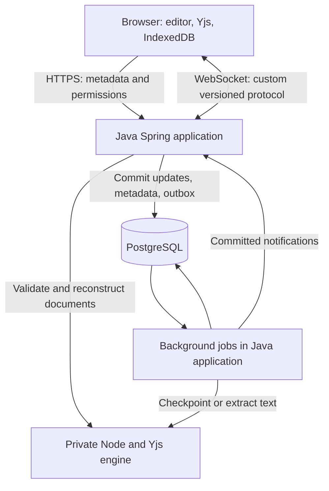

# 1. Architecture and foundations

## 1.1 The product, expanded

Imagine a team maintaining an incident report. Alice edits the timeline while Bob writes the resolution. Bob's connection disappears for a minute. Alice keeps editing. When Bob reconnects, the application must combine compatible edits, show the resulting document, and explain whether his changes are merely local or durably saved.

Later, an owner restores yesterday's revision. Bob's old browser must not silently reintroduce today's content. If Bob loses access, reconnecting with an old token must not bypass that change.

These are separate problems: merging content, transporting messages, keeping data, controlling access, and defining product behavior. A WebSocket solves only part of transport.

### Required scope

| Capability | User-visible behavior | Backend responsibility |
|---|---|---|
| Workspace and document management | Create, list, rename, archive documents | Tenant-scoped queries and transactions |
| Membership | Owner, editor, viewer | Explicit permission checks and revocation |
| Concurrent editing | Changes appear in other browsers | Authorized durable append and fanout |
| Temporary offline use | Continue an already loaded document | Local persistence and safe reconciliation |
| Save status | Local, pending, saved, or rejected | Acknowledgement with a defined meaning |
| Presence | Names and cursors appear and expire | Ephemeral, bounded, authenticated room state |
| History | Save and inspect named revisions | Immutable reconstructable revision content |
| Restore | Selected state becomes current | New epoch, atomic switch, reconnect policy |
| Search | Find permitted documents | Derived text plus current authorization |
| Operational recovery | Restart without losing committed edits | Replay, checkpoints, backups, tests |

Rich text is part of the first complete product. Later extensions: anchored comments, mentions, export, multiple gateway instances, object storage, and optional Kafka consumers. Excluded initially: public anonymous editing, arbitrary embedded HTML, end-to-end encryption, active-active regional writes, billing, mobile applications, and a custom CRDT algorithm.

## 1.2 Concepts before components

**Replica:** a local copy of shared state. Alice's browser, Bob's browser, and the document engine can each hold one.

**Convergence:** replicas eventually agree after receiving the necessary accepted updates. Agreement does not mean every human intention survived. Two people may make logically contradictory edits that still produce one deterministic document.

**CRDT:** a data structure with merge rules that support convergence under stated assumptions. We use Yjs rather than inventing a text algorithm. Its binary update API supports duplicate and differently ordered delivery. [Yjs update documentation](https://docs.yjs.dev/api/document-updates)

**Durability:** committed data survives the failures named in our guarantee. A gateway restart and total destruction of all database disks are different failure models.

**Idempotency:** retrying one logical request does not repeat its business effect. Applying CRDT bytes twice safely does not automatically prevent duplicate audit records or notifications.

**Checkpoint:** a stored state plus a precise log boundary, so recovery need not replay from the beginning.

**Epoch:** a document generation number. Restore changes the generation; old-generation writes are rejected.

**Backpressure:** controlling work when the producer is faster than the consumer. This requires bounded queues and explicit overload behavior.

**Outbox:** a database row written with a business change, then delivered asynchronously. It closes the gap between committing data and remembering to publish a notification. Delivery can repeat. [Transactional outbox pattern](https://microservices.io/patterns/data/transactional-outbox.html)

## 1.3 Why saving the whole text fails

Both users read `Hello`. Alice saves `Hello Alice`. Bob saves `Hello Bob` shortly afterward. A last-write-wins string replacement loses Alice's change.

An optimistic version check can detect the conflict and return an error. That is appropriate for a title or settings form. It does not provide a pleasant character-by-character offline editor by itself.

An operational-transformation design adjusts operations against concurrent operations, usually with a coordinated revision history. A CRDT design gives changes mergeable identities and rules. Both can support collaborative editing; neither is automatically superior for every product. Yjs is our choice because its existing editor and browser-persistence ecosystem matches the requirements.

For a same-position insertion, the application should not promise that wall-clock time or arrival order determines final text. The selected CRDT determines the order. Tests must verify convergence and actual editor semantics, including deletion and Unicode behavior.

## 1.4 Recommended first architecture

One deployable Java application contains cohesive modules. Jobs initially run inside it. The private Yjs engine is a second process because Java does not acquire Yjs interpretation merely by storing byte arrays. A reverse proxy serves the browser and routes requests to Java under one origin when deployed.

### Responsibilities

| Component | Owns | Does not own |
|---|---|---|
| Browser | Local editing, local persistence, pending queue, rendering | Truth about permission or server durability |
| Java HTTP layer | Request parsing, authentication context, response mapping | SQL or CRDT internals in controllers |
| Java application layer | Use cases and transaction boundaries | Editor rendering |
| Java collaboration module | Sessions, framing, rooms, queues, recovery | Reimplementing CRDT internals |
| Yjs engine | Decode/apply/encode, materialize, validate supported content | Final permission or database-commit decisions |
| PostgreSQL | Accepted log, membership, metadata, revisions | Live cursor delivery |
| Background jobs | Checkpoints, search projections, delivery retries | A second independent source of document truth |

This runtime split is a project design decision, not an official Yjs-prescribed Java architecture.

### Why not six microservices immediately?

An edit and a permission change already demand careful coordination. Independent services add network failures, deployment compatibility, and distributed transaction questions before the basic behavior is correct. Modules preserve separation without requiring independent deployments.

Extract a process when there is evidence: document computation consumes too much memory, background work interferes with edit latency, or separate scaling materially reduces cost. Do not create a service just because a folder has a different name.

## 1.5 Spring choice and teaching approach

Start with Spring MVC for HTTP, Spring's servlet WebSocket API for persistent connections, and JDBC for explicit SQL. Explain the container, beans, constructor injection, request mapping, validation, exception handling, and transactions in that order.

Spring supports WebSockets outside WebFlux. Therefore real-time collaboration does not require a fully reactive backend. [Spring WebSocket API](https://docs.spring.io/spring-framework/reference/web/websocket/server.html)

WebFlux remains a valid later alternative when measurements and dependency choices justify a nonblocking pipeline. Its reactive model requires handling blocking work carefully. JDBC must not be run on an event loop as though it were nonblocking. [Spring WebFlux overview](https://docs.spring.io/spring-framework/reference/web/webflux/new-framework.html)

Java virtual threads may help synchronous I/O concurrency, but they do not increase database connections or eliminate queue limits. WebSocket connection management still needs lifecycle handling and serialized sending. We will not assume enabling a Boot setting moves every callback onto a virtual thread.

The normal browser WebSocket API does not provide automatic application backpressure. Server framework support does not remove the need for client queue management. [MDN WebSocket API](https://developer.mozilla.org/en-US/docs/Web/API/WebSocket)

## 1.6 Corrections to the supplied brief

| Brief assumption or omission | Refined decision |
|---|---|
| Java treats bytes as opaque but also generates snapshots/search | Add an explicit Yjs-compatible engine for interpretation |
| Kafka is part of the starting stack | Start with a PostgreSQL commit; introduce Kafka only with a concrete need |
| WebFlux implies solved backpressure | Bound browser, room, engine, executor, and outbound queues |
| `y-websocket` can be paired with any JSON envelope | A custom envelope requires a custom provider, or exact existing protocol support |
| CRDT idempotence solves retry handling | Use application IDs and database uniqueness for business effects |
| A sequence generated before commit is a safe replay cursor | Serialize per-document sequence allocation with the commit |
| State-vector equality proves identical document state | Test deletion synchronization too; a vector is not a complete content checksum |
| A Yjs snapshot is necessarily a standalone backup | Distinguish a historical marker from full encoded reconstructable state |
| Restore can reuse the same active client document | Create a new generation and a fresh client document instance |
| Pub/Sub loss will be repaired on reconnect | Add periodic repair while the socket remains connected |
| Revocation takes effect magically on every connection | Specify write ordering and an explicit read-revocation window |
| A server failure guarantee means disaster recovery is solved | Separate process crash recovery, replication, and backup recovery |

The standard provider has its own behavior and scaling suggestions; using its library name does not make a custom protocol wire-compatible. [Yjs WebSocket provider](https://docs.yjs.dev/ecosystem/connection-provider/y-websocket)

## 1.7 Durability and consistency contract

**Write acceptance:** a `SAVED` acknowledgement means the exact update was accepted into the current document epoch and committed in PostgreSQL with the configured synchronous durability settings. It does not mean every peer has rendered it or the search index has caught up.

**Local editing:** visible immediately, possibly before any server accepts it. The UI must distinguish this from durable saving.

**Peer state:** eventually convergent for valid accepted updates delivered to compatible replicas. During disconnection, views may differ.

**Metadata and permissions:** managed with database transactions. We do not describe the entire application as having one consistency level.

**Failure boundary:** with durable storage and correct PostgreSQL settings, acknowledged writes are intended to survive application crashes and database process recovery. Async replica promotion and total storage loss require additional infrastructure and may lose data. PostgreSQL explicitly distinguishes synchronous WAL flush from asynchronous acknowledgement. [PostgreSQL commit durability](https://www.postgresql.org/docs/current/wal-async-commit.html)

**Revocation:** a write ordered after the revocation transaction cannot be newly accepted. For reads, the initial version checks access before each server dispatch. Multiple instances later use invalidation plus a proposed maximum five-second authorization lease; this is a documented weaker read-freshness bound. Already delivered or in-flight bytes cannot be recalled, and offline copies cannot be remotely erased reliably.

## 1.8 Explicit invariants

| ID | Invariant | Evidence required |
|---|---|---|
| I1 | Cross-workspace access is rejected on every data path | Negative API, socket, search, revision, export tests |
| I2 | No `SAVED` before the configured durable commit succeeds | Crash and lost-response tests |
| I3 | One request ID identifies one payload in one document epoch | Duplicate and conflicting-payload tests |
| I4 | An old epoch cannot modify the current epoch | Restore/reconnect race test |
| I5 | A published checkpoint includes exactly its declared committed prefix | Concurrent compaction and replay tests |
| I6 | No session or room queue grows without a bound | Slow-reader and hot-room tests |
| I7 | No newly accepted write bypasses current permission | Concurrent revoke/write test |
| I8 | Search, presence, and exports cannot grant document access | Projection and cache isolation tests |
| I9 | No prospective uncommitted candidate is broadcast as accepted state | Engine success / database failure test |
| I10 | Supported offline state remains recoverable or is explicitly rejected | Long-disconnect, migration, and restore tests |

## 1.9 Scaling path

First measure one instance. Then add a second gateway and Redis Pub/Sub for low-latency notifications. PostgreSQL remains authoritative; each gateway repairs missing notifications by reading the durable log. Presence can expire without replay.

Redis Pub/Sub has at-most-once delivery, so a successful publish is not proof every browser received the edit. [Redis Pub/Sub](https://redis.io/docs/latest/develop/use-cases/pub-sub/)

If document processing becomes expensive, use bounded caches of committed state and later explicit room ownership. Consistent hashing selects an owner but does not prove that an old owner has stopped. A monotonic fencing token checked by the write authority is required before ownership becomes a correctness mechanism.

Kafka's first role, if needed, is downstream events from the outbox, such as indexing and audit processing. PostgreSQL remains the ACK boundary. A Kafka-first edit log is a separate architecture change requiring a new decision about permissions, epochs, ordering, retention, and recovery. It is not a configuration switch.

## 1.10 Honest differentiation

Build a failure demonstration panel that shows local/pending/saved status, current epoch, last contiguous received sequence, and the recovery outcome. Keep detailed internal diagnostics in a developer mode.

The final portfolio demonstration should explain one trade-off clearly, reproduce three failures, show a measured limit, and identify what would change at greater scale. That is stronger evidence than claiming to have built a Google Docs equivalent.
