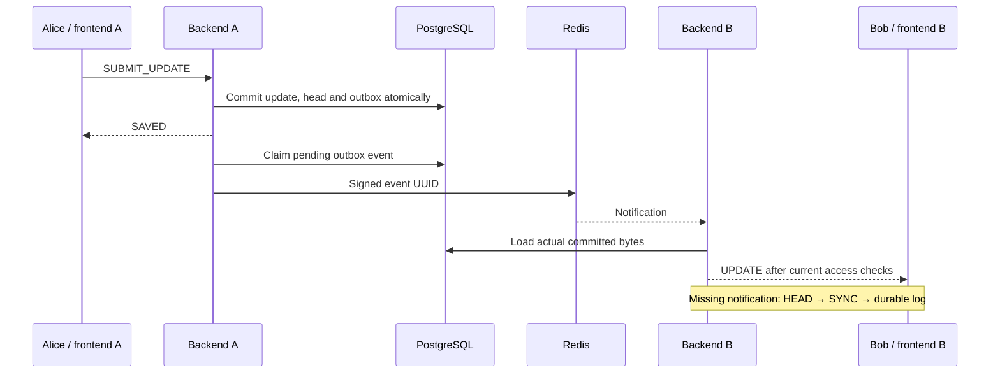

# Lesson 35 — Collaborate across two backend instances

## What users get

Alice can open a document through backend A while Bob opens the same document through backend B. Committed edits and cursor presence travel between the instances. If Redis loses a notification or becomes unavailable, the browsers recover committed edits from PostgreSQL using the existing HEAD/SYNC protocol. Redis failure does not reject an otherwise valid edit.

This is a local learning milestone. Both instances use the existing local PostgreSQL development database and private Yjs engine. The rich-text feature gate remains off by default; the live multi-instance test uses plain text. Session failover, distributed quotas and production deployment are outside this lesson.

## Why the old relay needed a bridge

Previously, each Java process knew only about its own document sockets. Both processes could read PostgreSQL, but the process claiming an outbox event could notify only its own peers. Periodic HEAD checks eventually repaired this, but remote typing and presence lacked a fast path.

Redis Pub/Sub supplies that fast path. It provides **at-most-once delivery**: a subscriber that misses a message cannot ask Redis to replay it. See the [Redis delivery semantics](https://redis.io/docs/latest/develop/pubsub/#delivery-semantics). Our database log remains the replay source.



Either backend may claim pending events with `FOR UPDATE SKIP LOCKED`. A successful publish marks the relay attempt in the existing outbox transaction. A failed publish rolls back that marking, so another attempt can retry. The user's update was committed in an earlier transaction and stays saved. `published_at` proves an attempted relay, not receipt by every browser.

Retries can duplicate notifications, including when a publish succeeds but the transaction fails afterward. Existing epoch, sequence and update-ID handling makes repeated delivery safe. No Redis message creates an update row. A receiver reloads the referenced event and current-epoch update from PostgreSQL before broadcasting. Unknown or retired-epoch pointers produce no update.

## Follow the implementation

| File/package | Responsibility |
|---|---|
| `backend/.../collaboration/cluster/ClusterBridge.java` | Sign/validate notifications, reload committed bytes, forward ephemeral presence and access hints |
| `backend/.../collaboration/cluster/ClusterConfiguration.java` | Opt-in local Redis connection, bounded executors, subscription recovery and gauges |
| `backend/.../collaboration/cluster/ClusterPublisher.java` | Small interface used by the existing relay |
| `backend/.../collaboration/cluster/LocalPresence.java` | Event emitted only for locally authenticated presence |
| `backend/.../collaboration/transport/DocumentDeliveryService.java` | Publish after local enqueue and before marking the relay attempt |
| `backend/.../collaboration/transport/DocumentDeliveryScheduler.java` | Run HEAD/access sweeps even when relay publication fails |
| `backend/.../collaboration/transport/DocumentRoomHub.java` | Deliver remote presence without republishing; close peers on observed role reductions |
| `backend/.../auth/SecurityConfiguration.java` | Delete the configured session cookie on logout |
| `ops/redis/` | Pinned, password-protected, loopback-only local Redis setup |

The `backend/...` paths start at `backend/src/main/java/com/example/collaborativeworkspace`. Spring's [Redis listener container](https://docs.spring.io/spring-data/redis/reference/redis/pubsub.html) manages subscriptions. There is no new browser protocol or HTTP endpoint in this lesson.

The bridge is enabled only in the `dev` profile with `workspace.cluster.enabled=true`. Default single-instance startup does not require Redis. Subscription attempts happen after startup and retry when Redis returns, so broker unavailability does not prevent the servlet application from starting.

## Boundaries and authorization

The channel is `workspace:<namespace>:v1`. Both nodes need the same namespace, Redis password and independently generated signing key. Redis database numbers do not isolate Pub/Sub channels; the namespace does. Tests use a random namespace.

Messages contain a version, random origin-node UUID, timestamp and an HMAC-SHA256 signature bound to the channel. Updates carry an event UUID only. Presence carries user/document/workspace/presence IDs, epoch and bounded relative positions. Email is reloaded from PostgreSQL at receipt. Passwords, session cookies and document update bytes are never put on the bus. HMAC authenticates trusted application nodes; it does not encrypt metadata.

Incoming messages are capped at 4,096 bytes, signatures are checked before database access, and messages more than 10 seconds old or 5 seconds in the future are ignored. Keep clocks reasonably aligned. Invalid JSON, bad signatures and invalid positions are discarded. Nodes ignore their own origin, and received notifications are never republished.

Remote presence requires the source user's current document access and matching epoch. Recipients still pass the room's current access check. Presence is disposable: missed cursor movement or leave notifications expire through the existing client expiry and refresh behavior. It is never written to the durable update log.

Membership reductions publish an after-commit hint that invalidates affected remote peers. The regular database authorization sweep remains necessary: it detects removals, archive changes and observed editor-to-viewer/owner reductions even when that hint is lost. Redis is never the authority for permission to save. As in Lesson 32, authorization/query/send timeouts and scheduling affect the revocation window; previously received data cannot be recalled.

Resource limits are explicit: one publisher worker with 64 waiting ephemeral tasks, two receiver workers with 64 waiting dispatch tasks, and one subscription worker. Redis uses a 250 ms command timeout, 500 ms connect timeout and a 64-request client queue. Dispatch or ephemeral saturation drops hints and increments counters; durable head repair remains available. These limits do not prove capacity under load. The existing socket limits of 256 total and eight per user apply **per instance**.

## Start the local arrangement

Use PowerShell 7 and a running Docker Desktop. From the repository root:

```powershell
./ops/redis/start-local.ps1
```

The script creates ignored `backend/.cluster.local.ps1` if missing, using two independent random 32-byte secrets, then starts the Compose service. Do not print or commit that file. Redis is published only on `127.0.0.1:6379`, requires its generated password, disables persistence and has a 64 MB limit. The image digest pins the tested Redis 8.2.11 build. PostgreSQL remains your existing local installation.

Start the private engine in its own terminal:

```powershell
cd experiments/yjs-private-engine
npm ci
npm run build
npm start
```

In backend terminal A, starting from the repository root:

```powershell
cd backend
. ./.env.local.ps1
. ./.cluster.local.ps1
$env:SPRING_PROFILES_ACTIVE = 'dev'
$env:WORKSPACE_CLUSTER_ENABLED = 'true'
$env:WORKSPACE_CLUSTER_NAMESPACE = 'local'
$env:SERVER_PORT = '8080'
$env:SERVER_SERVLET_SESSION_COOKIE_NAME = 'NODE_A_SESSION'
$env:WORKSPACE_WEBSOCKET_ALLOWED_ORIGIN = 'http://127.0.0.1:5173'
mvn spring-boot:run
```

In backend terminal B, use the same commands with these values:

```powershell
$env:SERVER_PORT = '8081'
$env:SERVER_SERVLET_SESSION_COOKIE_NAME = 'NODE_B_SESSION'
$env:WORKSPACE_WEBSOCKET_ALLOWED_ORIGIN = 'http://127.0.0.1:5174'
```

Set those values before running `mvn spring-boot:run`. Both nodes must use the same PostgreSQL database and private-engine configuration from the existing local setup.

In two frontend terminals, from `frontend`, install dependencies once with `npm ci`, then start:

```powershell
# Frontend A
$env:WORKSPACE_PROXY_TARGET = 'http://127.0.0.1:8080'
npm run dev -- --port 5173
```

```powershell
# Frontend B
$env:WORKSPACE_PROXY_TARGET = 'http://127.0.0.1:8081'
npm run dev -- --port 5174
```

Open `http://127.0.0.1:5173` as Alice and `http://127.0.0.1:5174` as Bob, sign in independently, and open an existing shared plain-text document. The document-creation API also accepts `format: "PLAIN_TEXT_V1"`; the current UI's rich-text creation path remains gated.

Cookies are scoped to hosts rather than ports, so the two backend cookie names must differ in this local arrangement. Sessions remain in memory in their owning backend. Copying a node-A cookie to node B does not authenticate there. A real deployment would need session affinity or a separately designed shared-session strategy; this lesson does not provide seamless session or cross-node logout failover.

## Verify and debug

Build the frontend (`npm run build`) and private engine first. From `backend`:

```powershell
. ./.env.local.ps1
. ./.cluster.local.ps1
$env:WORKSPACE_RUN_DB_TESTS = 'true'
$env:WORKSPACE_RUN_YJS_ENGINE_TESTS = 'true'
$env:WORKSPACE_RUN_BROWSER_TESTS = 'true'
$env:WORKSPACE_RUN_CLUSTER_TESTS = 'true'
$env:WORKSPACE_RUN_SEARCH_BROWSER_TESTS = 'false'
Remove-Item Env:WORKSPACE_BROWSER_TEST_GREP -ErrorAction SilentlyContinue
mvn -B test
```

For only the new integration fixture: `mvn -B '-Dtest=MultiInstanceIntegrationTest' test` with the same environment. The fixture verifies the dedicated test database before writing, creates two independent servlet applications in the test JVM, starts two Vite proxies and drives real Chromium contexts. Relay work is deliberately restricted to A so B's UPDATE frames prove bus delivery. The test-only authenticated fault-control server and TCP proxy exist only under `src/test`; no production fault endpoint is added. The proxy blocks only the test nodes' Redis connections and leaves the actual local Redis service running.

Coverage includes unavailable-broker startup and resubscription; bidirectional edits and presence; node-local session isolation; forced loss of B's notification followed by HEAD/SYNC repair; repeated signed notifications without extra update rows; saved edits and pending outbox rows during a broker outage; role downgrade with the bus unavailable; and outbox draining after recovery. Unit tests reject wrong keys/channels, tampering, stale/overflowing timestamps, oversized input, unknown update pointers and presence from revoked or old-epoch sources.

Recorded verification on 2026-11-13:

| Check | Result |
|---|---|
| Full Maven run with database, engine, browser and cluster flags | 156 tests, zero failures/errors/skips; includes existing development-browser and production offline-shell scenarios |
| Final focused run after adding two more bridge cases and the pending-outbox assertion | Five bridge tests and the real two-instance browser fixture passed; latest combined Java reports contain 158 tests, zero failures/errors/skips |
| Private Yjs engine | 31 tests passed |
| Frontend | TypeScript and Vite production build passed |
| Maven runtime advisory lookup | 106 package/version pairs queried against OSV, zero matching advisories at query time |

The focused browser scenario completed in 10.6 seconds. This is functional verification on one development machine, not a throughput benchmark, an exhaustive security audit or evidence of production availability.

The new `workspace.operation` stages are `cluster_publish` and `cluster_receive`. `workspace.transport` adds `cluster_unavailable`, `cluster_invalid` and `cluster_dropped`. Gauges expose `workspace.cluster.publisher.queued`, `workspace.cluster.receiver.queued` and `workspace.cluster.subscribed`. Subscription state is a local observation, not proof of remote delivery. Existing outbox age and pending gauges show durable retry backlog. Update receive/send logs retain the stored edit correlation ID at the broadcast boundary; presence has no durable edit correlation. No document body or credential is logged by the bridge.

If edits arrive only after periodic repair, check both nodes' namespace/key settings, subscription state and invalid-message counters. If Redis is down, expect outbox age to rise while saves and HEAD/SYNC remain usable. Restore the service and verify the outbox drains. Do not make metrics public to troubleshoot; the Lesson 34 bootstrap access rules still apply.

## Roll back and discuss

Stop the two Java processes, set `WORKSPACE_CLUSTER_ENABLED=false`, and restart the usual single backend and frontend. Restore the normal cookie/origin/port settings in that shell. No schema rollback is required. To stop only this disposable Redis service, dot-source `backend/.cluster.local.ps1` and run `docker compose -f ops/redis/compose.yaml down` from the repository root. Keep PostgreSQL intact.

Practice explaining: Why can an outbox retry deliver duplicates? Why does Redis publishing successfully say nothing about Bob receiving the edit? Why must HEAD/SYNC and current-membership queries keep working independently of the bus? As an exercise, inspect the outbox and subscribed gauges during an outage without reading document payloads.

Next: **Lesson 36 — overload and recovery experiments**, measuring slow consumers, hot rooms and bounded queues under an explicit workload.
